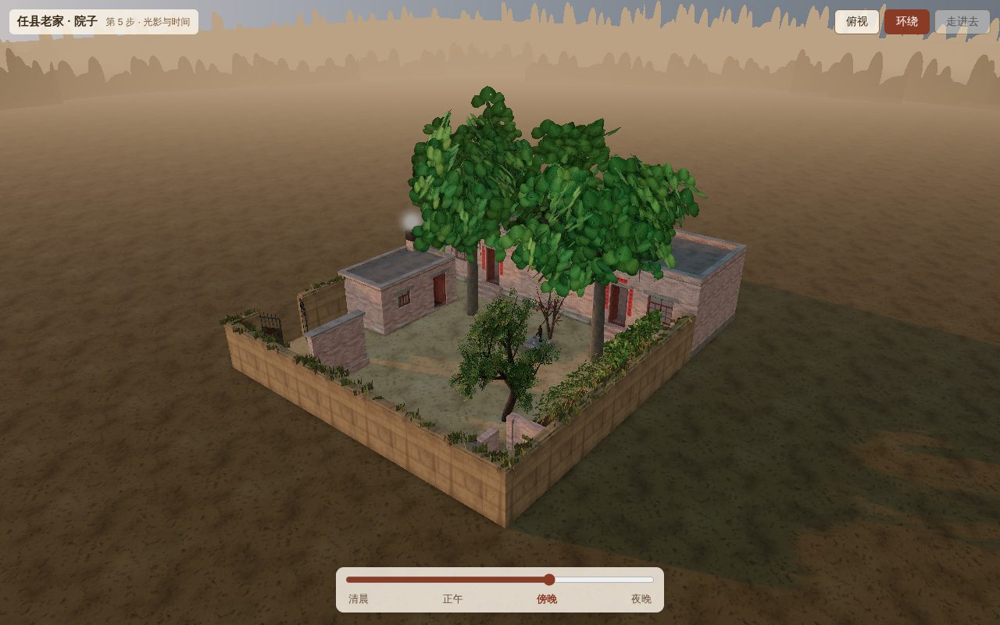
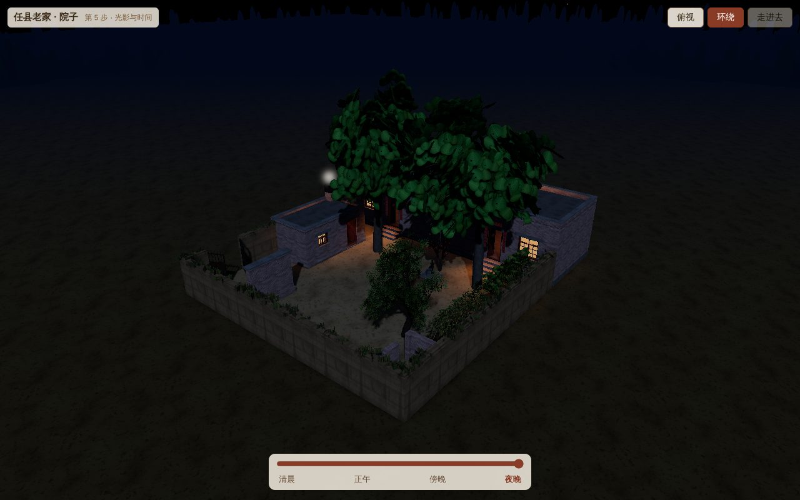
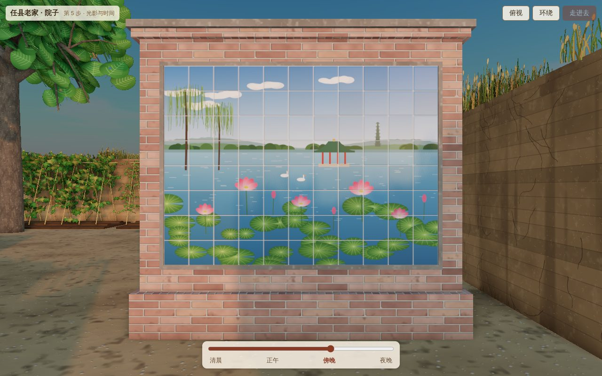
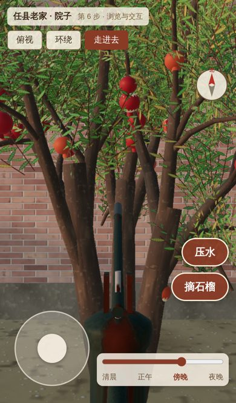

# 老家的院子 · laojia-yuanzi

用 Three.js 做的写实 3D 场景，复刻河北邢台任县农村老家的院子（约 1990 年代，我七八岁时）。初秋，石榴和枣都结满了果子。

## 👉 在线打开

**https://songyutao0408-dot.github.io/laojia-yuanzi/**

电脑、手机（包括 iPhone）浏览器都能直接打开。第一次打开要现场生成砖墙、土墙、树叶等贴图，会显示进度条，一般几秒钟。

## 发给家人：单文件版（不用联网）

- 下载：[laojia-yuanzi.html](https://github.com/songyutao0408-dot/laojia-yuanzi/releases/download/latest/laojia-yuanzi.html)（约 0.7 MB）
  - 也可以从网站直接下载：https://songyutao0408-dot.github.io/laojia-yuanzi/laojia-yuanzi.html （右键“另存为”）
- 双击用浏览器打开就行，不需要联网，所有内容都在这一个文件里
- 可以通过微信、QQ、邮件发给家人。手机上收到后，选“用浏览器打开”（微信里的预览可能打不开）
- 每次网站更新，这个文件也会自动更新

| 傍晚（默认） | 夜晚 |
|---|---|
|  |  |
| 进门迎面的影背墙 | 手机上：走到井边点“压水” |
|  |  |

## 怎么看

右上角三个按钮切换视角：

| 按钮 | 用途 | 电脑 | 手机 |
|---|---|---|---|
| **俯视** | 从正上方看整个院子（上北下南） | 拖动平移，滚轮缩放 | 单指平移，双指缩放 |
| **环绕** | 从东南方斜上方看，可以转着看 | 左键拖动旋转，滚轮缩放，右键平移 | 单指旋转，双指缩放/平移 |
| **走进去** | 以七八岁小孩的视线（1.2 米）走进院子，从大门口开始 | W A S D 或方向键走，按住 Shift 跑；按住鼠标拖动转头 | 左下角摇杆走，屏幕其它地方滑动转头 |

- 屏幕下方的**时间滑块**：清晨 / 正午 / 傍晚 / 夜晚，可以拖到中间看过渡。夜晚北屋窗户透出灯光，满天星星
- 右上角的**指北针**始终指向北
- **背景音乐**：原创的怀旧小曲（古筝、竹笛的味道），循环播放。浏览器规定要先点一下页面才能出声；指北针左边的 ♪ 按钮可以开关，会记住你的选择。iPhone 上如果没声音，看看侧边静音开关
- 墙、树干、窗户都穿不过去；门前台阶会一级级走上去，能走进两间北屋和厨房，也能从大门走出去

### 能做的事（在“走进去”里）

- **压水**：走到石榴树下的压水井旁，点屏幕上出现的“压水”按钮（电脑也可以按 **E**），压杆一上一下，水流进铁桶
- **摘石榴**：走到石榴树跟前，点“摘石榴”，或直接点画面上的石榴
- **打枣**：走到茅厕北边的枣树下，点“打枣”
- 右上角会记着“兜里”摘了几个；刷新页面果子会重新长出来

### 小提示

- 网址后面可以加参数：`?time=night` 直接看夜晚（还有 `dawn` 清晨、`noon` 正午）；`?view=walk` 直接走进去；`?quality=low` 强制低画质
- 画质会按设备自动调整：手机和老电脑用低画质（贴图分辨率减半、关掉环境光遮蔽），运行中如果太卡，还会自动再降一档

## 院子里有什么

坐北朝南的农家小院，东西 15 米、南北 18 米：北屋两间（西北屋、东北屋），门前两棵十米高的泡桐（当地叫“梧桐”），中间一棵石榴树，树下一口压水井；西边是厨房（冒着炊烟）、土墙和西南角朝西开的铁门，进门迎面是贴着荷花瓷砖画的影背墙；东南角是茅厕，旁边一棵大枣树；东墙下是丝瓜、豆角的菜地。

- 完整描述：[docs/scene-spec.md](docs/scene-spec.md)
- 俯视平面图：[docs/plan.svg](docs/plan.svg)

## 开发

```bash
npm install
npm run dev            # 本地预览
npm run build          # 构建网站到 dist/
npm run build:single   # 构建单文件版到 dist-single/index.html
```

项目结构、坐标约定、实现约定见 [CLAUDE.md](CLAUDE.md)。合并到 `main` 后，GitHub Actions 会自动部署网站并更新单文件版的 Release。
